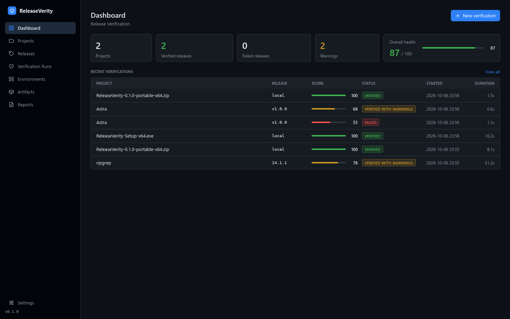
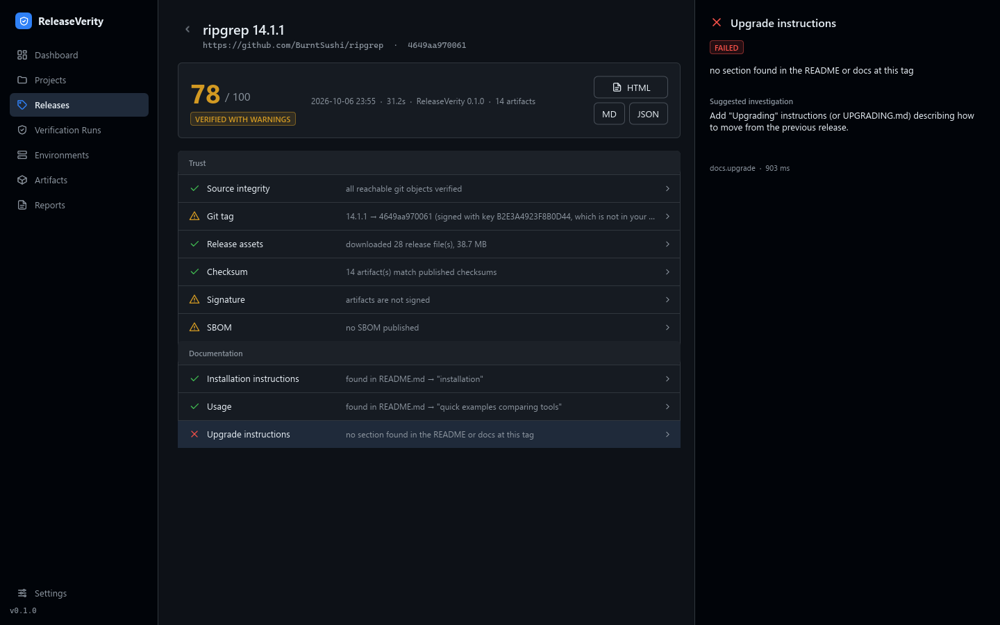
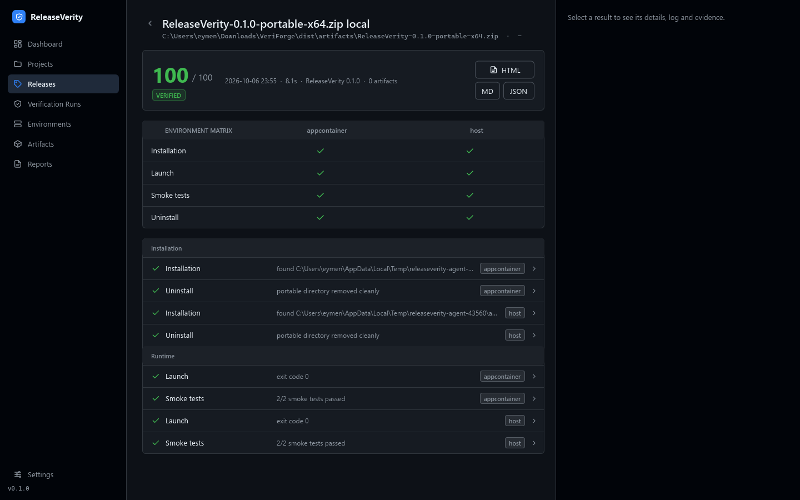
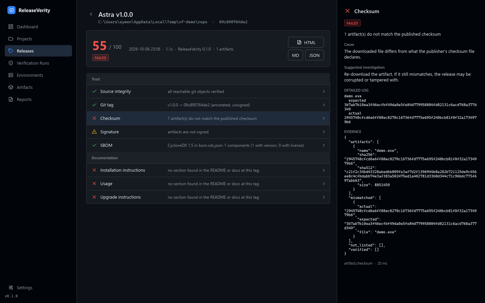
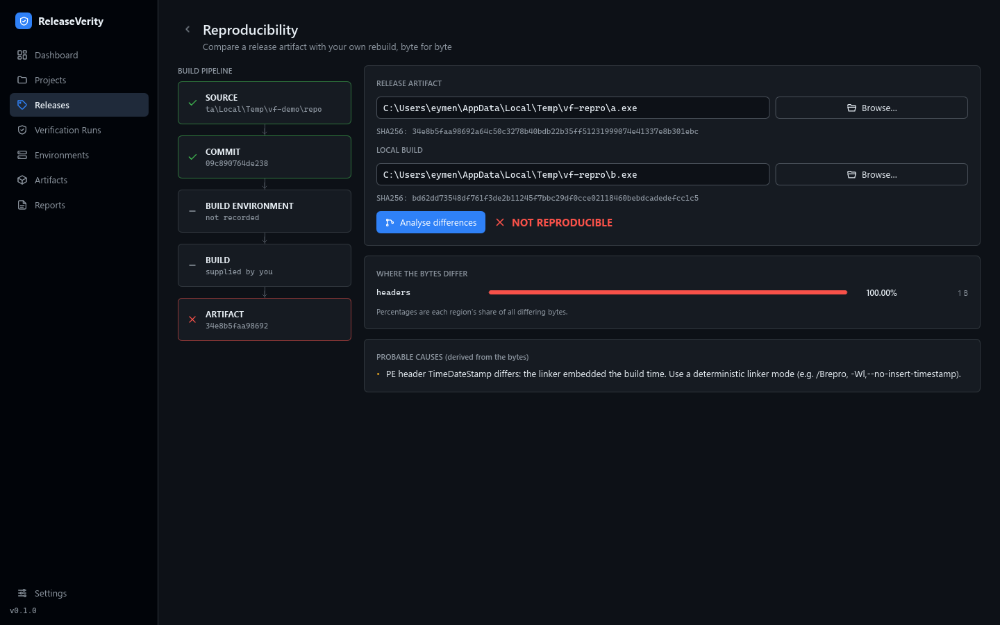
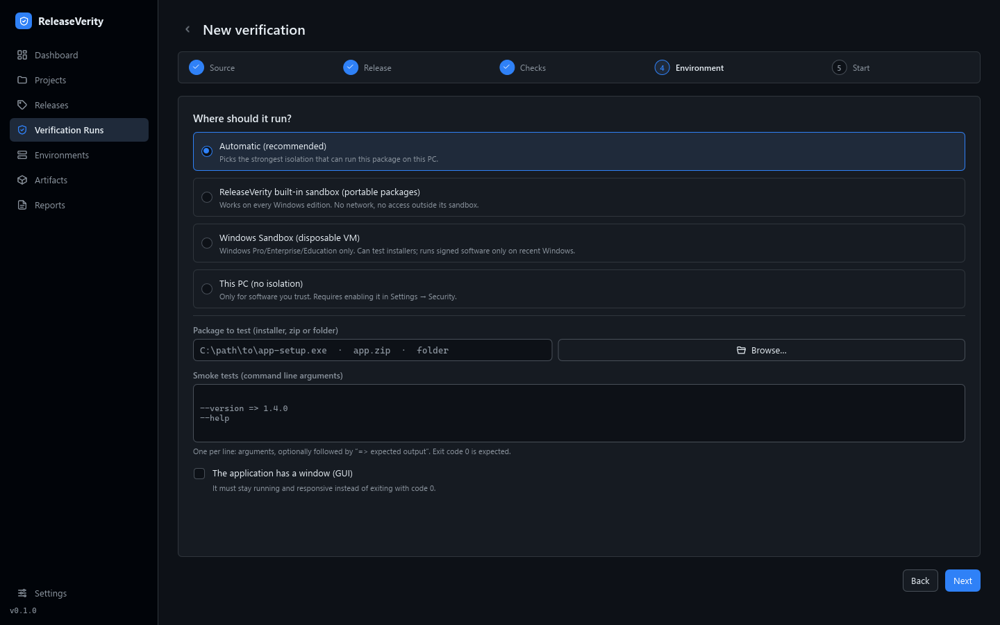
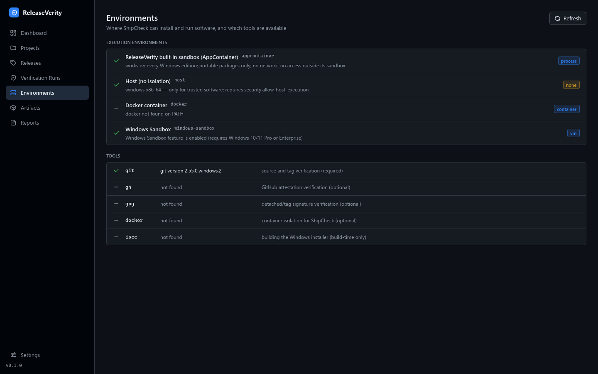
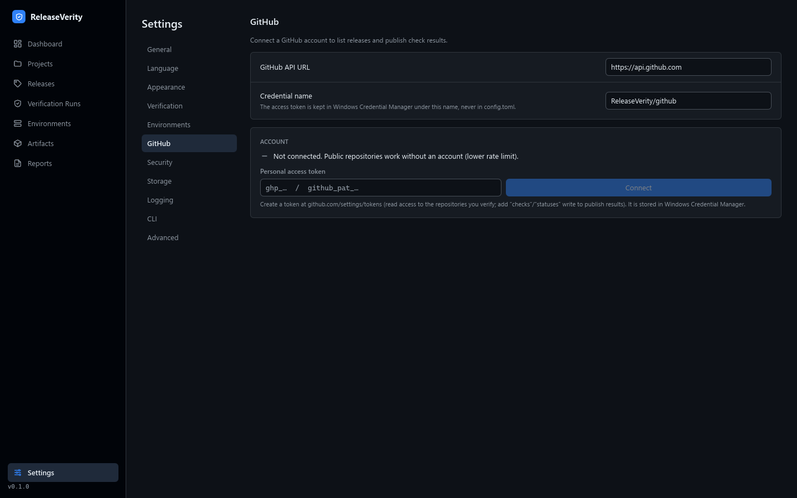
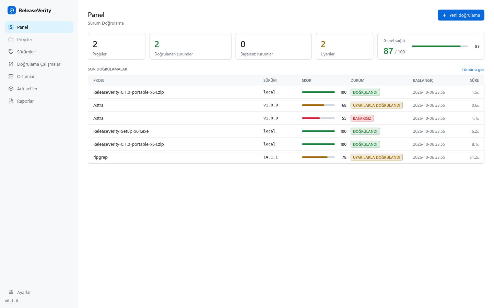
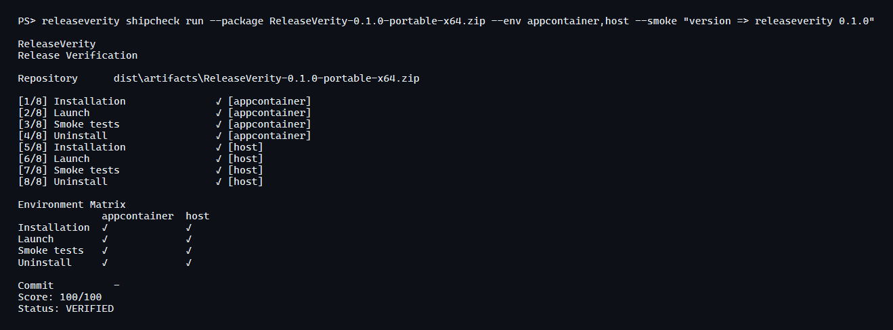

<div align="center">

# ReleaseVerity

**Is this release trustworthy, consistent with its source, installable, and does it actually run?**

ReleaseVerity verifies software releases end to end — supply chain, reproducibility, installation and runtime — from a native Windows desktop app, a CLI and a GitHub Action, all driven by the same engine.

[English](README.md) · [Türkçe](README.tr.md)



</div>

---

## In ten seconds

```text
Release ──▶ ReleaseVerity ──┬─ Supply chain      git tag → commit, checksums, signatures, provenance, SBOM
                        ├─ Reproducibility   release artifact vs. your rebuild, byte for byte, with the *reason* it differs
                        ├─ Installation      real installer run in a clean environment, real uninstall
                        ├─ Runtime           launch, crash / hang / timeout detection, smoke tests, exit codes
                        └─ Release quality   docs, score and a verdict ─▶  VERIFIED · WITH WARNINGS · FAILED
```

Nothing is simulated. Checksums are computed, git objects are verified, installers are executed, process exit codes are read, binaries are diffed. When ReleaseVerity cannot measure something it says **"Could not verify"** or **"Not available yet"** — it never invents a pass.

## Screenshots

All screenshots are taken from the real application running on real data (including a real public release, [ripgrep 14.1.1](https://github.com/BurntSushi/ripgrep/releases/tag/14.1.1)).

| | |
|---|---|
|  **Release detail** – every check is clickable: cause, suggestion, log, evidence |  **Environment matrix** – install / launch / smoke / uninstall per environment |
|  **A tampered release** – real checksum mismatch with expected vs. actual hashes |  **Reproducibility** – byte-level diff attributed to regions, with the probable cause |
|  **Guided verification** – source, release, checks, environment |  **Environments** – what isolation is really available on this PC |
|  **Settings** – GitHub account (token in Windows Credential Manager) |  **Türkçe + light theme** |



## Features

**Repro Engine** — `crates/releaseverity-repro`
- Git repository integrity (`git fsck`), tag → commit resolution, tag signature check
- SHA-256 / SHA-512 of release artifacts, compared against published `SHA256SUMS` / `*.sha256`
- Authenticode (Windows' real verifier) and detached GPG signatures
- SLSA / in-toto provenance: digest binding (and `gh attestation verify` for the cryptographic check)
- SBOM discovery and validation (CycloneDX / SPDX)
- Reproducibility: compare a release artifact with your own rebuild; PE / ELF / ZIP aware **binary diff** that attributes differing bytes to sections and names the cause (timestamp, leaked build path, PDB identity, entry order…)

**ShipCheck Engine** — `crates/releaseverity-shipcheck`, `crates/releaseverity-agent`
- Installs and runs the package in an isolated environment, observes it with Job Objects (process tree, memory and process limits, hard timeouts)
- Distinguishes **APPLICATION CRASHED**, **APPLICATION HUNG** (window stops responding) and **TEST TIMEOUT**
- Verifies the uninstaller really removes files and the Add/Remove Programs entry
- Smoke tests: arguments, expected exit code, expected output
- Documentation checks (installation / usage / upgrade sections at the release tag)

**Isolation backends** (chosen automatically, see [docs/shipcheck.md](docs/shipcheck.md))

| Backend | Where | Isolation | For |
|---|---|---|---|
| `appcontainer` — **ReleaseVerity's own sandbox** | every Windows edition | OS-enforced: no network, no access outside its sandbox | portable packages |
| `windows-sandbox` | Windows Pro / Enterprise / Education | disposable VM | installers *(signed software only on recent Windows — see limitations)* |
| `host` | anywhere | **none** — explicit opt-in only | software you trust |

**Product** — one core, three front ends
- Native Windows desktop app (Rust + [Slint](https://slint.dev), **no web view**), English and Türkçe, dark and light themes
- CLI with identical capabilities; colour optional, `--ascii` and `--json` modes, meaningful exit codes
- GitHub integration: repositories, tags, releases, release assets, commits, Actions runs, PRs, checks; results published back as a **Check Run**
- Local-first: SQLite storage, no server. Tokens live in Windows Credential Manager, never in files
- Reports in HTML, Markdown and JSON

## Installation

Download from the [Releases](../../releases) page:

| File | What |
|---|---|
| `ReleaseVerity-Setup-x64.exe` | Installer (Program Files, Start Menu, optional desktop shortcut, optional `releaseverity` on PATH) |
| `ReleaseVerity-<version>-portable-x64.zip` | Portable folder — settings live next to the app in `data\` |
| `SHA256SUMS`, `ReleaseVerity-<version>.cdx.json` | Checksums and SBOM — verify ReleaseVerity with ReleaseVerity |

Requires Windows 10 / 11 x64. The binaries are statically linked: no Visual C++ Redistributable needed.

```text
ReleaseVerity\
├── ReleaseVerity.exe            desktop app
├── releaseverity-agent.exe      the test agent that runs inside the clean environment
├── cli\releaseverity.exe        command line tool
├── resources\               icon.ico, third-party notices
├── locales\                 en.json, tr.json
├── config\                  (portable build only) marks the folder as portable
└── docs\
```

## CLI

```powershell
releaseverity doctor                                   # tools, storage and execution environments
releaseverity project add Astra --repo https://github.com/example/astra

# supply chain + documentation of a GitHub release (assets are downloaded for you)
releaseverity verify --repo https://github.com/example/astra --release v1.4.0 --report html,json

# the same, with an installer test in a clean environment
releaseverity verify --repo https://github.com/example/astra --release v1.4.0 \
    --package .\Astra-Setup.exe --installer-args "/VERYSILENT /SUPPRESSMSGBOXES /NORESTART" \
    --smoke "--version => 1.4.0" --env windows-sandbox

# only installation and runtime testing of a package, no repository
releaseverity shipcheck run --package .\app.zip --exe app.exe --launch-args "--version" --smoke "--version => 1.4.0"

# does my rebuild match the release? and if not, why?
releaseverity repro compare .\release\app.exe .\my-build\app.exe

releaseverity report export --run 12 --format html --out report.html
releaseverity github login --stdin < token.txt         # stored in Windows Credential Manager
releaseverity verify --repo ... --release v1.4.0 --publish   # publish the verdict as a GitHub Check
```

Exit codes: `0` verified (or warnings without `--strict`), `1` failed, `2` error/usage, `3` inconclusive. Full reference: [docs/cli.md](docs/cli.md).

## Desktop app

**New verification** walks through *source → release → checks → environment → start*. The live screen shows real progress: each line is driven by an event from the engine (cloning, hashing, downloading, installing, launching…), and the bar is *finished steps ÷ planned steps*, not a timer. Open any finished run to see the score, the **Environment Matrix**, and click any result for cause, suggested investigation, the full log and the evidence JSON.

## Verification workflow

```text
Repository / tag ─▶ git fsck ─▶ tag → commit ─▶ release assets (downloaded) ─▶ checksums
        ─▶ signatures ─▶ provenance ─▶ SBOM ─▶ rebuild comparison ─▶ documentation
        ─▶ clean environment ─▶ installer ─▶ files & registry ─▶ launch ─▶ smoke tests ─▶ uninstall ─▶ cleanup
        ─▶ score + verdict ─▶ SQLite ─▶ HTML / Markdown / JSON report ─▶ (GitHub Check)
```

Score: weighted checks (pass 1.0, warning 0.6, fail/error 0); skipped checks are excluded. Verdict: any *critical* failure (source integrity, tag, checksum, install, launch, smoke tests) or a failure with score < 60 → **FAILED**; only warnings → **VERIFIED WITH WARNINGS**; checks that could not run and nothing failed → **INCONCLUSIVE**.

## GitHub Action

```yaml
- uses: Orevian/releaseverity-action@v1
  with:
    release: ${{ github.ref_name }}
    strict: false
```

Downloads ReleaseVerity, verifies the release, writes JSON/HTML reports, publishes a GitHub Check and fails the workflow if the release fails. See [integrations/github/action](integrations/github/action/README.md).

## Architecture

```text
                       ReleaseVerity Core  (models · SQLite · config · logging · i18n · scoring · reports)
                             │
         ┌───────────────────┼───────────────────┐
        CLI              Desktop (Slint)     GitHub Action
         └───────────────────┼───────────────────┘
                    releaseverity-services          ← the one API every front end uses
                             │
              ┌──────────────┼───────────────┬──────────────┐
         Repro Engine   ShipCheck Engine   GitHub client   Credential store
                             │
                      releaseverity-agent  (runs inside AppContainer / Windows Sandbox / host dir)
```

The CLI and the GUI contain no business logic. Details: [docs/architecture.md](docs/architecture.md).

## Security model

Untrusted software is executed during ShipCheck, so ReleaseVerity is built to stay safe while testing it: isolation first (own AppContainer sandbox, Windows Sandbox VM), host execution only on explicit opt-in, Job Objects for process-tree control, memory/process limits, hard timeouts, guaranteed cleanup, and everything the agent reports is treated as untrusted *data* (size-limited and validated). Details and honest limits: [docs/security-model.md](docs/security-model.md) and [SECURITY.md](SECURITY.md).

## Limitations (what is *not* done yet)

ReleaseVerity states its limits instead of faking results:

- **Windows Sandbox** requires Windows Pro/Enterprise/Education, and on recent Windows builds Smart App Control is enforced *inside* the sandbox, so only signed, reputable programs (including ReleaseVerity's own agent, which is unsigned until code signing is set up) can run there. ReleaseVerity detects this and reports it precisely. For unsigned installers use a VM without Smart App Control, a clean CI runner, or `--env host` for software you trust.
- **ReleaseVerity's built-in sandbox** runs *portable* packages only — installers must write `Program Files` and `HKLM`, which needs a VM.
- **Rebuilding** the release in a sandbox is not automated yet: reproducibility compares a rebuild you supply.
- **Provenance** signatures are verified cryptographically only through `gh attestation verify`; without it ReleaseVerity reports "digests match, signature not verified" (a warning, never a pass).
- **Performance** checks, **PDF export** (print the HTML report), **GitHub OAuth device flow** (tokens are personal access tokens), and **Hyper-V / Linux / macOS runners** are on the roadmap.
- ShipCheck and the desktop app are Windows-only; the Repro Engine and CLI also build on Linux.
- The released binaries are not code-signed yet, so Windows SmartScreen may warn on first run.

## Development

```powershell
git clone https://github.com/Orevian/ReleaseVerity
cd ReleaseVerity
cargo test --workspace                       # unit + integration + end-to-end tests
cargo run -p releaseverity-cli -- doctor         # the CLI
cargo run -p releaseverity-desktop               # the desktop app
cargo clippy --workspace --all-targets -- -D warnings
```

Requirements: Rust (stable, MSVC toolchain), Git. Layout and conventions: [CONTRIBUTING.md](CONTRIBUTING.md).

## Build

One script, every artifact — the version is read from `[workspace.package]` in `Cargo.toml` (single source of truth) and the icon is the repository's `icon.ico`, embedded unmodified:

```powershell
scripts\build.ps1 -Target cli          # dist\cli\releaseverity.exe
scripts\build.ps1 -Target desktop      # desktop executable
scripts\build.ps1 -Target portable     # dist\portable\ReleaseVerity\  + zip + SBOM + SHA256SUMS
scripts\build.ps1 -Target installer    # dist\installer\ReleaseVerity-Setup-x64.exe   (needs Inno Setup 6)
scripts\build.ps1                      # everything
```

If `icon.ico` is missing the build stops with an explicit message. Inno Setup: `winget install JRSoftware.InnoSetup`.

## Release

Push a tag `vX.Y.Z`: the [release workflow](.github/workflows/release.yml) builds the portable zip and the installer, generates the SBOM and `SHA256SUMS`, attaches build provenance, and publishes the GitHub Release. ReleaseVerity's own ShipCheck is used to test its own installer.

## Roadmap

Automated sandboxed rebuilds · Hyper-V checkpoint backend · Linux/macOS runners · performance checks · GitHub App + OAuth · PDF reports · code signing · incremental indexing for very large repositories.

## License

[Apache-2.0](LICENSE). Third-party notices ship with every build (`resources\THIRD_PARTY_NOTICES.md`).
